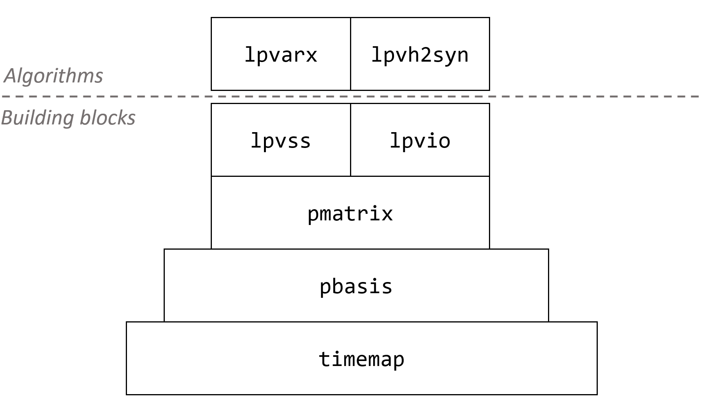

# LPVcore

## Quick guide

A beginners tutorial is located at `examples/tutorial.m`.

## Installation

The following toolboxes are required for LPVcore:

 * Control Systems Toolbox
 * Optimization Toolbox
 * Robust Control Toolbox
 * Statistics and Machine Learning Toolbox
 * System Identification Toolbox

The following toolboxes are required for the synthesis algorithms:

 * [YALMIP](https://yalmip.github.io/)
 * [SDPT3](https://github.com/SQLP/SDPT3)
 * [ROLMIP](https://rolmip.github.io/)

To install LPVcore, add the `src` folder to your path:

```
>> addpath(genpath('src'))
>> savepath
```

## Folder structure

* `examples`: example scripts to illustrate toolbox functionalities.
* `src`: the main source code of the toolbox.
    * `core`: fundamental LPV-related objects and functions shared across different applications.
    * `lib`: various utility functions.
    * `sysid`: sytem identification tools.
    * `synthesis`: controller synthesis tools.
* `test`: test scripts and functions that are part of the automated testing procedure. We use [GitLab CI/CD Pipelines](https://docs.gitlab.com/ee/ci/pipelines/).
* `test.m`: function to invoke tests or example scripts for validating the functional behavior of LPVcore. Useful to run after you make any changes to ensure you haven't introduced bugs.
* `lint.m`: script to recursively lint (i.e, check code quality) of the code base of LPVcore. Useful to run after you make any changes to ensure your syntax does not trigger warnings by MATLAB.

## Fundamental concepts

LPVcore is an end-to-end toolbox for users of Linear Parameter-Varying (LPV) system framework.
The toolbox is designed to be simple to use, yet powerful enough to support a wide variety of use cases such as system identification, control synthesis and analysis. The following diagram shows the fundamental classes that can be used in the development of algorithms such as `lpvarx` or `lpvh2syn`. For more information on these fundamental classes, consult their documentation in `src/core` or look at the example scripts in `examples`.




