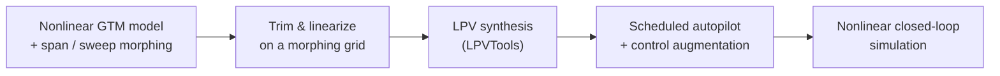

<div align="center">

# LPV Control of a Variable Span-Sweep Morphing Aircraft

**A gain-scheduled autopilot that stays tuned while the wing changes shape.**

[](https://doi.org/10.2514/6.2019-0106)
[](https://doi.org/10.2514/6.2019-0106)


[](https://github.com/nasa/GTM_DesignSim)


<sub>Variable-span and variable-sweep morphing aircraft (Fig. 1 of the paper)</sub>

</div>

## Why

A morphing wing changes the aircraft's aerodynamics continuously. A single linear controller tuned at one configuration loses performance elsewhere in the morphing envelope. Treating the span/sweep configuration as a **scheduling parameter** turns this into a linear parameter-varying (LPV) design problem: one controller family, valid across the whole envelope.

## How it works



- Longitudinal and lateral **autopilots** plus inner-loop **control augmentation systems (CAS)**
- Gains **scheduled online** as span and sweep vary
- Validated in the nonlinear simulation, with 3-D flight-path visualization

<div align="center">


<sub>Weighted interconnection used for the controller synthesis (Fig. 4 of the paper)</sub>
</div>

## Quick start

```matlab
cd GTM_DesignSim/gtm_design
setup        % add paths, including LPVTools
lpv_design   % trim + linearize across the morphing grid, then synthesize the scheduled controllers
```

<details>
<summary><b>Repository layout</b></summary>

- `GTM_DesignSim/` — NASA GTM_DesignSim-based nonlinear aircraft simulation (see its own `README.md`)
  - `gtm_design/design/` — `trim_gtm.m`, `linearize_gtm.m` (trim and linearization across the morphing grid); `design_lon_autopilot.m`, `design_lon_cas.m`, `design_lat_autopilot.m`, `design_lat_cas.m` (autopilot and CAS design)
  - `gtm_design/lpv_design.m` — top-level LPV design script
  - `gtm_design/misc/` — `tune_cas_lon.m`, `tune_cas_lat.m` (CAS tuning helpers)
  - `gtm_design/plot/` — design and response plots, including `plot_morphing_effect.m` and `trim_map.fig`
  - `gtm_design/sfunction/` — S-function blocks (rigid-body dynamics, NDI, control-augmentation variants)
  - `gtm_design/data/` — saved trim/linearization results and the `FixedWingBus` definition
  - `gtm_design/trajectory3/` — reference trajectories and aircraft silhouettes for 3-D flight-path visualization
  - `gtm_design/LPVToolsV1.0/` — LPVTools toolbox (MUSYN / University of Minnesota)

</details>

## Related publications

| | Publication |
|---|---|
| **This code** | [Linear Parameter-Varying Control of Variable Span-Sweep Morphing Aircraft](https://jihoonlee91.github.io/papers/2019-lpv-variable-span-sweep-morphing.html) — *AIAA SciTech 2019* |
| Earlier | [Quasi-LPV Modeling and Parameter-dependent Optimal Control of Morphing Wing Aircraft](https://jihoonlee91.github.io/papers/2018-quasi-lpv-modeling-optimal-control.html) — *ICAS 2018* |
| Later | [Self-Scheduled LPV Control of Asymmetric Variable-Span Morphing UAV](https://jihoonlee91.github.io/papers/2023-self-scheduled-lpv-asymmetric-morphing-uav.html) — *Sensors 2023* |
| Later | [Self-Scheduled Parameter-Varying Control of Asymmetric Variable-Span Morphing UAV](https://jihoonlee91.github.io/papers/2023-msc-thesis-lpv-asymmetric-morphing.html) — *Ph.D. dissertation, SNU 2023* |

The simulation base is shared with [`gtm-morphing-sim`](https://github.com/jihoonlee91/gtm-morphing-sim).

## Citation

```bibtex
@inproceedings{lee2019lpv,
  title     = {Linear Parameter-Varying Control of Variable Span-Sweep Morphing Aircraft},
  author    = {Lee, Jihoon and Kim, Seong-hun and Jung, Seungyun and Lee, Hanna and Kim, Youdan},
  booktitle = {AIAA Scitech 2019 Forum},
  address   = {San Diego, CA},
  year      = {2019},
  doi       = {10.2514/6.2019-0106}
}
```

## Acknowledgements

[NASA GTM_DesignSim](https://github.com/nasa/GTM_DesignSim) (NASA Open Source Agreement — see `GTM_DesignSim/LicenseAgreement.pdf`) · LPVTools (MUSYN / University of Minnesota)

<sub>Part of my Ph.D. research at the Seoul National University Flight Dynamics and Control Lab — more at <a href="https://jihoonlee91.github.io/">jihoonlee91.github.io</a>.</sub>
