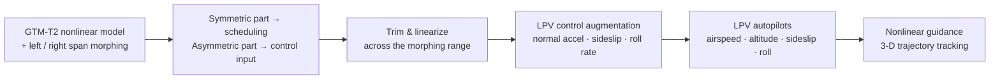

<div align="center">

# Self-Scheduled LPV Control of an Asymmetric Variable-Span Morphing UAV

**Left and right wing spans as control effectors — LPV control augmentation, autopilots, and 3-D guidance on NASA's GTM-T2.**

[](https://doi.org/10.3390/s23063075)
[](https://doi.org/10.3390/s23063075)
[](https://jihoonlee91.github.io/papers/2023-phd-dissertation-lpv-asymmetric-morphing.html)


[](https://matlab.mathworks.com/open/github/v1?repo=jihoonlee91/morphing-uav-lpv-control&file=GTM_DesignSim/gtm_design/lpv_design.m)
[](https://github.com/nasa/GTM_DesignSim)


<sub>How the aircraft's parameters change as the left wing span varies (Fig. 2 of the Sensors paper)</sub>

</div>

## Highlights

- **Two wing spans, two jobs.** The left/right span ratios split into a symmetric part (an LPV scheduling parameter) and an asymmetric part (a roll-control input alongside the ailerons and rudder).
- **Guarantees between design points.** LPV synthesis over a 63-point grid (synthetic airspeed × altitude × morphing) keeps stability for arbitrarily fast parameter variation, not just at each design point.
- **Where it shows.** In a helical climb with extremely fast morphing, a pointwise H∞ design diverges while the LPV controller keeps tracking (*Sensors* 2023).

## Why

Changing the wing span changes lift, drag, and moments. If the **left and right spans can move independently**, span morphing becomes more than a performance knob — the difference between the two sides is a roll-control effector. The left/right span ratios are decomposed into a **symmetric part, used as the LPV scheduling parameter**, and an **asymmetric part, used as a control input**.

## How it works



- **Control augmentation systems** tracking normal acceleration, angle of sideslip, and roll rate
- **Autopilots** for airspeed, altitude, angle of sideslip, and roll angle
- **Guidance scenarios**: waypoint following, orbit following, helical climb and descent
- LPV vs. H∞ comparison plots for push-over/pull-up and high-g turn maneuvers

## Requirements

- MATLAB R2020b or later with Simulink
- Control System Toolbox, Robust Control Toolbox (`hinfsyn`, `sysic`), Aerospace Toolbox (`atmosisa`)
- For the Simulink model: Aerospace Blockset (unit-conversion and transform blocks), UAV Toolbox, and Robotics System Toolbox (guidance blocks)
- LPVTools v1.0 is bundled (`GTM_DesignSim/gtm_design/LPVToolsV1.0/`); `setup` adds it to the path
- Precompiled S-function MEX binaries for Windows, macOS, and Linux are included, so no C compiler is needed

## Quick start

```matlab
cd GTM_DesignSim/gtm_design
setup        % add paths, including LPVTools
lpv_design   % trim + linearize across the morphing range, then synthesize the controllers
```

A quick check that your MATLAB has everything (it also runs in CI on every push): `runtests("tests")` from the repository root — loads the saved design, trims one design point, and flies two seconds.

<details>
<summary><b>Repository layout</b></summary>

- `GTM_DesignSim/` — NASA GTM_DesignSim-based nonlinear aircraft simulation (see its own `README.md`)
  - `gtm_design/mfiles/morphing_effect.m` — left/right span morphing effect on geometry and aerodynamics
  - `gtm_design/design/` — `trim_gtm.m`, `linearize_gtm.m` (trim and linearization); `design_lon_cas.m`, `design_lat_cas.m`, `design_lon_autopilot.m`, `design_lat_autopilot.m` (CAS and autopilot design)
  - `gtm_design/lpv_design.m` — top-level LPV design script
  - `gtm_design/misc/` — `tune_cas_lon.m`, `tune_cas_lat.m` (CAS tuning helpers)
  - `gtm_design/plot/` — `CAS/` (push-over/pull-up, high-g turn; LPV vs. H∞), `autopilot/` (waypoint, orbit, helical climb/descent), `plot_morphing_effect.m`, `trim_map.fig`
  - `gtm_design/sfunction/` — S-function blocks (rigid-body dynamics, NDI, control-augmentation variants)
  - `gtm_design/data/` — saved trim/linearization results and the `FixedWingBus` definition
  - `gtm_design/trajectory3/` — reference trajectories and aircraft silhouettes for 3-D flight-path visualization
  - `gtm_design/LPVToolsV1.0/` — LPVTools toolbox (MUSYN / University of Minnesota)

</details>

## Limitations and future work

The model is quasi-static: unsteady aerodynamics during morphing are not modeled, because the base GTM model does not include them. Open items from the dissertation work (tracked as issues #15–#23 until 2026):

- Refine the center-of-mass and inertia modeling, and the quadratic dependence of the rolling and yawing moment coefficients on the left/right morphing parameters
- Close the loop with realistic sensor and actuator models in the LPV simulation, including anti-aliasing filters
- Add model uncertainty, wind, and disturbance rejection to the synthesis and the nonlinear simulation
- Choose the morphing configuration online (a line search with one morphing parameter; a real optimization with several)

A plain-language walkthrough of the approach is on the blog: [Using wing span as a control input](https://jihoonlee91.github.io/blog/wing-span-as-a-control-input.html).

## Related publications

| | Publication |
|---|---|
| **This code** | [Self-Scheduled LPV Control of Asymmetric Variable-Span Morphing UAV](https://jihoonlee91.github.io/papers/2023-self-scheduled-lpv-asymmetric-morphing-uav.html) — *Sensors 2023* |
| **This code** | [Self-Scheduled Parameter-Varying Control of Asymmetric Variable-Span Morphing Unmanned Aerial Vehicle](https://jihoonlee91.github.io/papers/2023-phd-dissertation-lpv-asymmetric-morphing.html) — *Ph.D. dissertation, SNU 2023* |
| Same aircraft — modeling | [Modeling and Simulation of Asymmetric Variable-Span Morphing Aircraft](https://jihoonlee91.github.io/papers/2019-asymmetric-morphing-modeling-sim-ko.html) — *KSAS Fall 2019 (in Korean)* |
| Same aircraft — NDI | [Flight Control of Asymmetric Variable-Span Morphing Aircraft Using Nonlinear Dynamic Inversion](https://jihoonlee91.github.io/papers/2019-flight-control-nonlinear-dynamic-inversion.html) — *APISAT 2019* |
| Same aircraft — NDI autopilot | [Aircraft Autopilot Design Using Asymmetric Variable-Span Wing Morphing](https://jihoonlee91.github.io/papers/2021-aircraft-autopilot-asymmetric-morphing.html) — *ICAS 2021* |
| Earlier LPV work (different aircraft: span-sweep UAV) | [Linear Parameter-Varying Control of Variable Span-Sweep Morphing Aircraft](https://jihoonlee91.github.io/papers/2019-lpv-variable-span-sweep-morphing.html) — *AIAA SciTech 2019* |

The simulation base is shared with [`morphing-uav-gtm-sim`](https://github.com/jihoonlee91/morphing-uav-gtm-sim).

## Citation

```bibtex
@article{lee2023selfscheduled,
  title   = {Self-Scheduled {LPV} Control of Asymmetric Variable-Span Morphing {UAV}},
  author  = {Lee, Jihoon and Kim, Seong-hun and Lee, Hanna and Kim, Youdan},
  journal = {Sensors},
  volume  = {23}, number = {6}, pages = {3075}, year = {2023},
  doi     = {10.3390/s23063075}
}

@phdthesis{lee2023dissertation,
  title  = {Self-Scheduled Parameter-Varying Control of Asymmetric Variable-Span Morphing Unmanned Aerial Vehicle},
  author = {Lee, Jihoon},
  school = {Seoul National University},
  year   = {2023}
}
```

GitHub's **Cite this repository** button uses [`CITATION.cff`](CITATION.cff).

## License and acknowledgements

Built on [NASA GTM_DesignSim](https://github.com/nasa/GTM_DesignSim) and distributed under the NASA Open Source Agreement 1.3 (`GTM_DesignSim/LicenseAgreement.pdf`); the bundled LPVTools (MUSYN / University of Minnesota) is AGPL-3.0 (`GTM_DesignSim/gtm_design/LPVToolsV1.0/agpl-3.0.txt`). See [`LICENSE.md`](LICENSE.md).

<sub>Ph.D. research at the Seoul National University Flight Dynamics and Control Lab — more at <a href="https://jihoonlee91.github.io/">jihoonlee91.github.io</a>.</sub>
